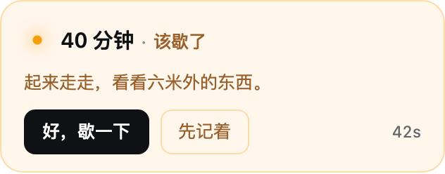
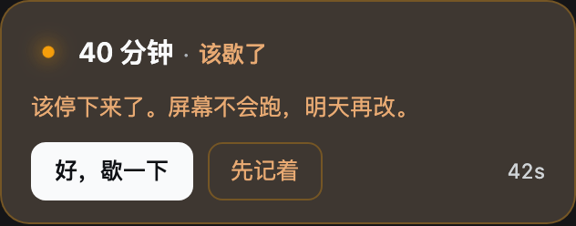
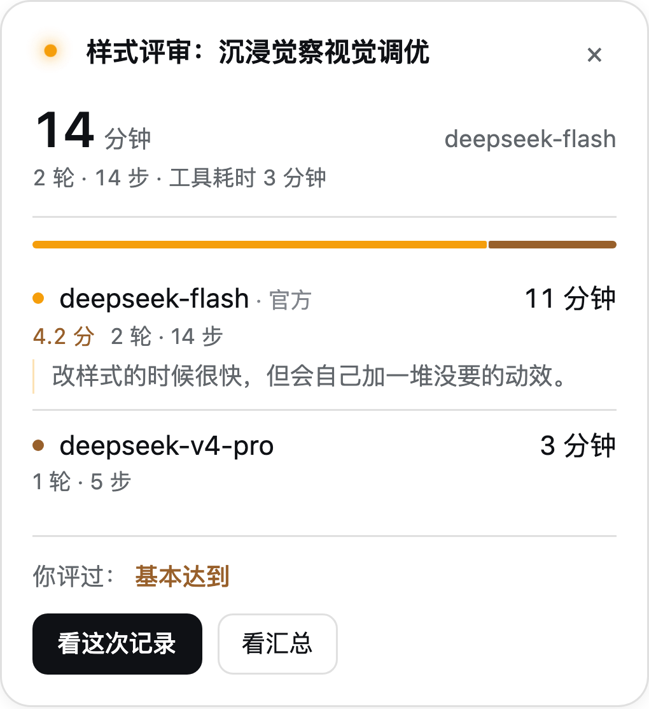
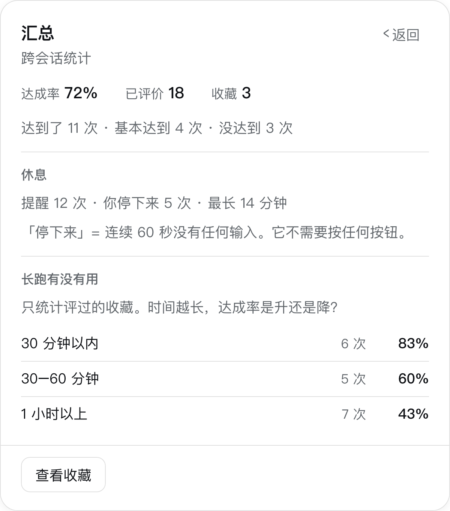
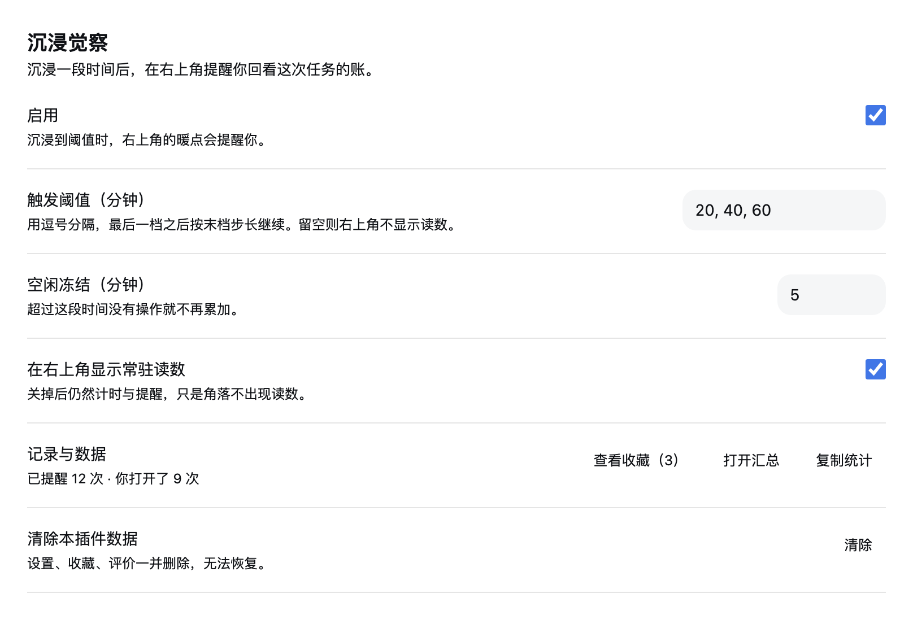
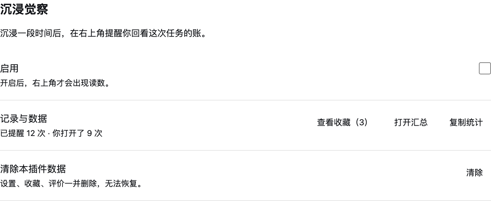

# 设计说明（DESIGN.md）

这份文件回答一个问题：**为什么它长这样。** 改样式之前先读它；改完如果结论变了，回来改它。

产品意图只有一个：**让沉迷 AI coding 的人抬头，然后离开屏幕一会儿。**
记录是副产品 —— 它存在的意义是让「刚才那一段」有个落点，而不是给用户一个继续盯着
屏幕看的仪表盘。

---

## 一、画面（先想清楚它该是什么）

> 晚上十一点，屏幕是屋里最亮的东西。你离它 40 厘米，刚让模型跑第二批测试。
> 角落里应该有一盏小灯，慢慢呼吸，像有人坐在旁边 —— 它不说话，直到你坐得太久。

这句话决定了三件事：

1. **暖**，但不是满屏暖。暖是这盏灯的颜色，不是界面的底色。
2. **呼吸**，而且慢。5 秒一次（12 次/分），接近安静坐着时的频率。
3. **安静**。除了一次提醒，它不发出任何要求。

## 二、三条硬规则

### 1. 颜色只从语义层取

`panel-css.js` 顶部的 `--ig-*` 是插件唯一的调色板，组件里不出现裸色值。

宿主**没有** `--dsw-alias-text-brand` / `--dsw-alias-label-warning` /
`--dsw-alias-text-success` / `--dsw-alias-label-error` 这四个名字。旧版用
`var(名字, 兜底值)` 引用它们，结果全部静默落到兜底值上 —— 而兜底值是按深色调的。
浅色主题下实测：

| 位置 | 旧 | 现在 |
|---|---|---|
| 提醒语 | 2.25:1 | 4.86:1 |
| 主按钮（白字压蓝） | 2.80:1 | 18.9:1（宿主主按钮 = 黑底白字） |
| 11px 说明文字 | 3.71:1 | 5.80:1 |
| 绿色评分 | 3.04:1 | 5.19:1 |

正确 token 与补偿方式：

```css
--ig-warm:         var(--dsw-alias-state-warn-primary);
--ig-warm-ink:     color-mix(in oklab, var(--dsw-alias-state-warn-label) 70%, var(--dsw-alias-label-primary));
--ig-warm-surface: color-mix(in oklab, var(--dsw-alias-bg-layer-2) 90%, var(--dsw-alias-state-warn-primary));
--ig-action:       var(--dsw-alias-button-primary-fill);
--ig-action-ink:   var(--dsw-alias-label-primary-foreground);
```

`color-mix` 前的第一种声明是兜底：不支持的环境仍然可读，只是没那么贴合主题。

### 2. 一个面板只有一层「面」

面板之上用**留白 + 0.5px 发丝线**分组。不再套第二层、第三层灰底圆角块 ——
旧版记录卡里是「面板 → 指标块 → 模型块」三层同色同圆角，等于没有层级。

判断标准：如果一个元素既没有不同的底色、也没有不同的圆角、又不承载独立操作，
它就**不该**有卡片外壳。

### 3. 动效只描述两件事

- **呼吸**：暖点的常态。`transform` + `opacity`，5 秒一轮。
- **推进**：面板之间的换层。6px 位移 + 淡入，220ms，`cubic-bezier(0.22, 1, 0.36, 1)`。

不用回弹曲线，不在 hover 上缩放，不给任何元素加「入场弹跳」。
`prefers-reduced-motion` 必须覆盖到**每一个**动画 —— 包括暖点本身。

## 三、右上角那盏灯

> 下面的图不是设计稿：它们是把组件要渲染的标记抄进一个静态页、只加载真实的宿主
> token 与 `panel-css.js` 截下来的。改样式后请重新截，别让文档和代码分叉。







### 形态

```
● 14 分钟 · 6 分钟后提醒你
```

- 暖点（`.ig-ember`）：外圈光晕呼吸，实心核轻微缩放。`--ig-heat`（0–1，本档内
  走了多少）只影响光晕铺开的半径 —— 它是唯一的「进度」表达。
- 数字只有一个（`.ig-hud-time`）。旧版环心与右侧是同一个 `activeMs`，
  收拢态实际显示「14 14 分钟」。
- 第二段（`.ig-hud-next`）说的是用户的未来：「6 分钟后提醒你」。

### 到点

暖点**停止呼吸**、定在全亮，同一位置长出一张卡：

```
● 40 分钟 · 该歇了
起来走走，看看六米外的东西。
[好，歇一下]  [先记着]        42s
```

- 主操作是「歇一下」，不是「看明细」—— 提醒的目的不是让用户看更多数据。
- 「歇一下」→ 读数进入 20 秒休息态：暖点把呼气拉长到 7 秒，文案变成
  「歇一会儿 · 看向远处 18s」。两个动作都清提醒。
- 面板已经开着的时候**不换成卡**，只在顶部出一条可点的提醒条：
  用户正在看明细，面板突然变成一张卡比多一个浮层更糟。

### 位置

`top = 量出的「会话头部下沿」 + 12px`（`--ig-safe-top`，由 [safe-top.js](../src/client/safe-top.js) 写入）。

- **为什么必须测量**：头部高度是内容驱动的（有没有标签页差近 26px），写死必然错位。
- **为什么是 12 而不是 20**：间距要跟着元素的体量走。旧药丸 54px 高，20px 只占四成；
  换成 31px 的细药丸后，同样的 20px 显得整条往下掉了。
- **量的是谁**：只认高度 32–140px、底边在视口上三分之一的容器，并跳过 `ig-` 前缀的
  节点 —— 否则窄窗口下面板会把自己量成头部，形成「越量越靠下」的正反馈。

### 为什么不是圆环

1. 环天生读作「完成度」，而它要表达的是「离该歇还有多远」，每个新用户都要被解释一遍；
2. 环心与右侧是同一个数；
3. 到提醒时它反而**变窄**（实测 225px → 179px），越该被看见的时候越不显眼。

## 四、展开面板（点读数之后）



三段，从上到下只有一个焦点：

1. **状态** —— 任务名（最多两行，超出截断）＋一个主数字（坐了多久）＋「现在哪个模型」，
   再加一行元信息（轮次 · 步数 · 工具耗时）。旧版把「模型耗时 / 工具耗时」做成两格，
   而每个模型行里又重复各自的耗时 —— 同一个数出现两遍，五块同权重的文字堆在一起。
2. **明细** —— 占比条与模型列表**贴在一起**（同一件事的两种读法）。一行里只有两个
   强信息：名字（左）与耗时（右对齐）；评分、轮次、步数降成第二行的元信息。
   旧版把评分塞在名字和耗时中间，一行四个东西，扫不过去。

   ⚠ **占比条只在两个以上模型时出现**。单模型时它是 100%，一整条纯色，读起来像
   进度条、实际零信息量（实测被误认为「设置错了」）。多模型时条与行用同一组三档
   暖色，行的左端有一个 6px 同色点，把「哪一段是哪个模型」对上。
3. **判断 + 出口** —— 你评过什么（值用暖色），以及「看这次记录 / 看汇总」。

区段之间用 0.5px 发丝线，不用大段留白：三段的重量不同，留白分不开，线可以。

## 五、记录卡


顶部只有一个主数字（沉浸时长），其余降成一行元信息；模型与目的确认各成一段，
用 0.5px 发丝线分隔，不再套灰底卡片。主操作固定在面板底部（sticky），
内容再长也不会把「收藏这张记录」推到折线以下。

主数字下面有一行暖色的「这次你停下来 N 次 · 最长 M 分钟」—— 汇总里那个累计数的
本段版本，出现在刚结束的一段里最即时。没停过就不占位。

## 六、汇总



汇总回答「我这些时间换来了什么」，四块：

0. **休息回执** —— 只数「停」，不数「服从」：连续 60 秒没有输入（且页面可见、
   模型不在回答）算一次。点了「歇一下」却接着打字不算；没点按钮但走开了照算。
   **没有「继续」这一栏，也没有完成率** —— 默认行为不是失败。累计为 0 时不显示。
1. **达成率** —— 只统计你评过的记录；没评的不进分母。
2. **长跑有没有用** —— 把你评过的记录按时长分三档（≤30 / 30–60 / 60 分钟以上），
   各自算一个达成率。这是「我常问什么」的隐私安全版：不问内容，只问「时间越长，
   结果越好还是越差」。对沉迷 AI coding 的人来说，这组数字比任何劝告都有用。
3. **模型排行** —— 客观指标 + 你的评分并排，不替你下结论。

⚠ **不做「常用提问排行」。** 那需要把每条 user 消息存进 localStorage，等于把
「只读首句 60 字」的边界扩大到「保存全部正文」；而且它奖励的行为是「继续翻自己的
聊天记录」，与「让你离开屏幕」正好相反。

## 七、设置页



宿主对两个设置插槽的分工写得很明确：

> `settings.general.item` — a single setting that needs no page of its own
> (a whole page is `settings.section`).

这个插件有 6 项设置 + 3 个数据操作，属于「一整页」。所以它注册成
`settings.section`（导航里一页「沉浸觉察」，order 12，排在「模型」与「内置插件」之间），
而不是挤在通用页的一行里。

页面用宿主自己的行语法：

- 标题 18 / 说明 13 作页头（与 `ui-settings-plugins` 的 `heading` / `intro` 同尺寸）；
- 每一行是「标题 14 + 说明 12 在左、控件在右」，行间 0.5px 发丝线；
- 控件 36px 高、module-platform 底、无边框 —— 与宿主的 stepper 同尺寸。

**关闭插件后，「记录与数据」和「清除」两行仍然在。** 它们是数据管理，不是
「要不要提醒」的从属项；旧版把它们一起藏了，等于关了插件就再也进不去画廊。



## 八、排版

一页里只有五档字号（旧版是九档，且相邻两档常常只差 0.5px）：

| 用途 | 字号 | 行高 |
|---|---|---|
| 元信息 / 标签 / 副行 | 11.5 | 16–17 |
| 正文 / 按钮 / 输入 / 说明 | 12.5 | 18–19 |
| 名称与数值（模型名、时长、指标） | 14 | 19–20 |
| 面板标题 / 提醒卡头条 | 15 | 22 |
| 记录卡主数字 | 26 | 32 |

两个例外是字形而不是文字：返回的 `‹` 与收起的 `×` 按图标尺寸给（16 / 15）。

- 数字一律 `font-variant-numeric: tabular-nums`。
- 低于 12px 的文字只用 `--dsw-alias-label-secondary`（浅色 5.80:1），
  **不用** `tertiary`（3.71:1）。
- 间距四档：4 / 8 / 12 / 18。

## 九、面板的行为约定

- **主操作固定在底部**（`.ig-card-actions` 是 sticky 的）。旧版记录卡内容 647px、
  容器上限 558px，被裁掉的正好是「收藏这张记录」，而滚动条又被藏了。
- **滚动条只藏不废**，但主操作不依赖用户猜到下面还有内容。
- 画面上同一时刻只有一个面板；「返回」回到读数，而不是「关闭」。
- 点空白关闭；记录卡支持 Esc。

## 十、文案

- 说人，不说 UI：「6 分钟后提醒你」而不是「已用时长 · 下次提醒还有 6 分钟」。
- 提醒卡的主语是「你」：「你已经坐了 40 分钟」比「已沉浸 40 分钟」更像人话。
- 不替用户下结论：汇总只给客观指标，判断留白。

## 十一、验收清单

改完样式，至少确认：

1. 浅色与深色各看一遍（本机默认是**浅色**，不要只在深色下调）；
2. 记录卡塞 6 个模型时，主操作仍在视口内；
3. 开「减少动态效果」后没有任何元素在动；
4. 所有正文文字对比度 ≥ 4.5:1（对照第二节的表）；
5. 右上角读数在常态/未读/休息三态之间切换时宽度稳定（不跳）。
